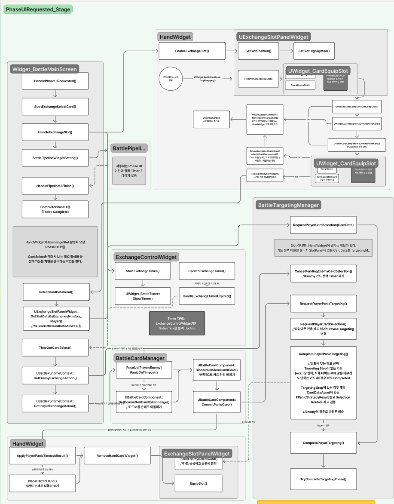
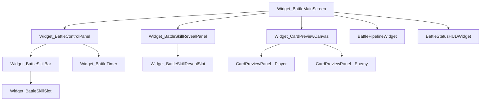

<h1 align="center">Muksi</h1>
<p align="center">Unreal Engine 5 기반 무협 턴제 전략 전투 게임</p>

<p align="center" style="line-height: 2;">
    
    
</p>

> 포트폴리오 제출을 위해 Source Code 중심으로 구성했으며,
> 외부 Asset 및 리소스는 Repository에서 제외했습니다.
> 
> Muksi는 현재 개발 진행 중인 프로젝트이며,
> 본 README에서는 제가 주로 담당한 **Battle System과 Battle UI의 현재까지 구현 내용**을 소개합니다.

<br/>

## 시연

> Battle System 시연

<p align="center">
  <a href="https://youtu.be/lPac3edVBL8">
    
  </a>
</p>

> BattleStart 이후 첫 번째 Round가 시작되어 RoundEnd에 도달하기까지,
> 한 Round의 전체 전투 흐름을 시연한 영상입니다.

> 각 Round는 RoundStart로 시작하며,
> 스킬 선택과 Simulation을 진행하고 ExchangeEnd로 마무리하는 과정을 3회 반복합니다.
> 이후 Battle Action Sequence에서 각 Exchange의 행동 그룹을 순차적으로 실행하고,
> BattleActionSequenceEnd와 RoundEnd로 이어집니다.

> 실제 게임에서는 이 Round 흐름을 전투가 종료될 때까지 반복합니다.

<br/>

## 목차

- [프로젝트 소개](#프로젝트-소개)
- [담당 역할](#담당-역할)
- [Battle Flow](#battle-flow)
- [상세 흐름도](#상세-흐름도)
- [주요 구현](#주요-구현)
- [Battle UI 구조](#battle-ui-구조)
- [Troubleshooting](#troubleshooting)
- [개발 회고](#개발-회고)

<br/>

## 프로젝트 소개

Muksi는 무협 세계관을 기반으로 한 턴제 전략 전투 게임입니다.

플레이어와 적은 각 Exchange에서 스킬과 대상을 선택하며,
Simulation을 통해 선택한 행동의 예상 결과를 확인합니다.
한 Round에서 3회의 Exchange가 완료되면,
선택한 행동을 Battle Action Sequence에서 순차적으로 실행합니다.

스킬의 코스트와 쿨다운을 고려한 행동 선택,
상대에게 실제 스킬을 숨기는 변초를 통해 전략적인 전투를 구성합니다.

현재 프로젝트는 개발 진행 중이며,
본 포트폴리오에서는 제가 주로 담당한 Battle System과 Battle UI를 중심으로 설명합니다.

| 항목 | 내용 |
| --- | --- |
| 장르 | 무협 턴제 전략 전투 |
| 엔진 | Unreal Engine 5.7.4 |
| 언어 | C++ |
| 개발 형태 | Team Project |
| 담당 영역 | Battle System / Battle UI |
| 개발 기간 | 2026.03 ~ 진행 중 |

<br/>

## 담당 역할

**Battle System / Battle UI Programming**

본 프로젝트에서 전투 Phase 진행과 Battle UI를 담당했으며,
기존 타겟팅 및 행동 실행 시스템과 연결하여 전투 흐름을 구성했습니다.

- `BattleManager` 기반 전투 Phase 흐름 구현
- `BattlePhasePipeline`과 연동한 Entry / UI / Prep / Execution Stage 진행 제어 구현
- `Widget_BattleMainScreen`을 중심으로 Phase별 UI 실행 및 완료 처리 연결
- 기존 Hand 기반 카드 UI를 9슬롯 스킬바 기반 선택 UI로 개편하고, 선택 UI와 공개 UI의 역할 분리
- 스킬 코스트·쿨다운 관리 및 상태 변경에 따른 UI 갱신 구현
- Exchange Timer, 선·후공 스킬 공개 및 미리보기 UI 구현
- 변초 스킬의 실제 정보 공개 및 Material 기반 디졸브 연출 구현
- Action Group 단위 전투 연출 제어 및 카메라 이동과 행동 실행 흐름 연결
- 캐릭터 상태, 상태 효과 표시 및 패시브 발동 팝업 등 전투 정보 UI 구현
- RichTextBlock 기반 상태 효과 키워드 표시 및 키워드 호버 시 상세 설명 팝업 연동
- Battle System 호출 흐름을 Figma로 문서화하고, 팀원과 클래스별 책임 및 인터페이스 정리

<br/>

## Battle Flow

### Battle Phase

`BattleManager`에서 현재 Battle Phase를 관리하며
각 Phase가 완료되면 다음 Phase로 진행하도록 구성했습니다.

```text
ReadyStart
    ↓
ReadyEnd
    ↓
BattleStart
    ↓
RoundStart
    ↓
┌─────────────────────────────────────┐
│ ExchangeStart                       │
│      ↓                              │
│ CardSelect                          │
│      ↓                              │
│ Targeting                           │
│      ↓                              │
│ CardReveal                          │
│      ↓                              │
│ SimulationSequence                  │
│      ↓                              │
│ ExchangeEnd                         │
└─────────────────────────────────────┘
          ↓ Exchange 총 3회 완료 후
BattleActionSequenceStart
    ↓
BattleActionSequenceEnd
    ↓
RoundEnd
    ↓
다음 Round 또는 BattleEnd
```

각 Exchange에서는 스킬 선택, 대상 지정, 스킬 공개,
Simulation이 순차적으로 실행되며, ExchangeEnd로 해당 Exchange를 마무리합니다.

한 Round에서 이 과정을 3회 반복한 뒤,
선택한 행동을 Battle Action Sequence에서 순차적으로 실행합니다.
이후 RoundEnd를 거쳐 전투 종료 여부에 따라 다음 Round 또는 BattleEnd로 진행합니다.

> 카드 시스템을 스킬 시스템으로 개편한 이후에도,
> 코드의 Phase 이름인 `CardSelect`와 `CardReveal`은 유지하고 있습니다.
> 각각 스킬 선택과 스킬 공개 단계를 의미합니다.

<br/>

### Phase Stage

각 Battle Phase 내부의 동작은 다시 4개의 Stage로 구분했습니다.

```text
PhaseEntryRequested_Stage
          ↓
PhaseUIRequested_Stage
          ↓
PhasePrepRequested_Stage
          ↓
PhaseExecutionRequested_Stage
          ↓
       Next Phase
```

`BattlePhasePipeline`은 각 Stage에서 Delegate를 통해
해당 시스템에 처리를 요청하고,
등록된 작업이 완료된 이후 다음 Stage로 진행합니다.

<br/>

## 상세 흐름도

### 전투 UI 호출 흐름 분석

전투 시스템과 UI를 연결하는 과정에서,
각 클래스의 역할과 함수 호출 순서를 파악하기 위해
CardSelect Phase의 UI Stage를 Figma로 정리했습니다.

이 자료를 바탕으로 팀원과 시스템 간 책임 및 인터페이스를 정리했으며,
이후 스킬바 기반 UI와 공개 연출을 구현하면서 구조를 개선했습니다.

다음 주요 구현에서는 전투 Phase 진행 제어,
UI 연결, 스킬 선택 및 공개 연출을 중심으로 설명합니다.

> 아래 흐름도는 카드 시스템에서 스킬바 시스템으로 기획이 변경되기 전에 작성한 자료입니다.
> 현재 구현과는 일부 클래스·함수명 및 세부 처리 흐름에 차이가 있으므로,
> CardSelect 단계의 UI 호출 흐름과 시스템 간 연결 관계를 이해하기 위한 참고 자료로 봐주시면 감사하겠습니다.

<p align="center">
  
</p>

`Widget_BattleMainScreen`을 시작점으로 Hand, Exchange Slot,
Timer, Card 및 Targeting 관련 시스템의 호출 관계를 정리했습니다.


[🔗 Figma에서 확대하여 상세 흐름 보기](https://www.figma.com/design/Utn3iyOoFEurf0v8SsA6QL/Muksi_Portfolio_BattleFlow?node-id=0-1&t=3MlWFX3hYDkjfRXZ-1)

<br/>


## 주요 구현

> 아래 코드는 핵심 흐름을 설명하기 위한 발췌본이며,
> 일부 로그와 관련 없는 분기는 생략했습니다.
> 
### 1. BattleManager 기반 전투 Phase 및 Stage 진행 제어

`BattleManager`를 중심으로 현재 전투 Phase를 관리하고,
각 Phase 내부의 Entry → UI → Prep → Execution Stage가
순차적으로 진행되도록 구현했습니다.

`BattlePhasePipeline`과 연동하여 각 Stage의 처리를 요청하고,
완료 통보를 받으면 다음 Stage를 시작하도록 구성했습니다.
이를 통해 UI 연출과 전투 준비 등 필요한 처리가 끝난 뒤
다음 단계로 진행하도록 제어했습니다.

#### 핵심 코드

**Phase 변경 및 진입 처리**

새로운 Phase로 변경할 때 이전 Phase와 현재 Phase를 갱신하고,
Entry Stage부터 실행합니다.
현재와 동일한 Phase가 요청되면 중복 진입을 방지합니다.

```cpp
void ABattleManager::ChangePhase(EBattlePhase NewPhase)
{
    if (CurrentPhase == NewPhase)
    {
        return;
    }

    if (!PhasePipeline)
    {
        return;
    }

    PreviousPhase = CurrentPhase;
    CurrentPhase = NewPhase;

    ExecutePhaseEntry();
}
```

**Stage 완료에 따른 순차 진행**

각 Stage의 완료 통보를 받으면,
현재 Phase에 해당하는 완료 요청인지 확인한 뒤 다음 Stage를 실행합니다.

```cpp
void ABattleManager::HandlePhaseEntryFinished(EBattlePhase FinishedPhase)
{
    if (!IsCurrentPhaseCompletion(FinishedPhase, TEXT("Entry")))
        return;

    ExecutePhaseUI();
}

void ABattleManager::HandlePhaseUIFinished(EBattlePhase FinishedPhase)
{
    if (!IsCurrentPhaseCompletion(FinishedPhase, TEXT("UI")))
        return;

    ExecutePhasePrep();
}

void ABattleManager::HandlePhasePrepFinished(EBattlePhase FinishedPhase)
{
    if (!IsCurrentPhaseCompletion(FinishedPhase, TEXT("Prep")))
        return;

    ExecutePhaseExecution();
}
```

Stage의 시작과 완료 후 전환을 `BattleManager`에서 제어하여,
전투 진행 순서를 한곳에서 파악할 수 있도록 구성했습니다.

#### 관련 코드

- `Source/Muksi/Contents/Battle/BattleManager.cpp`
- `Source/Muksi/Contents/Battle/BattleManager.h`

#### 연동 코드

- `Source/Muksi/Contents/Battle/Flow/BattlePhasePipeline.cpp`
- `Source/Muksi/Contents/Battle/Flow/BattlePhasePipeline.h`

<br/>

### 2. Battle UI Flow

`Widget_BattleMainScreen`을 중심으로
전투 Phase에 따른 UI 실행과 관련 시스템 사이의 연결을 구현했습니다.

`BattleManager`의 `PhaseUIRequestedDelegate`를 받아
현재 Phase에 필요한 하위 UI를 실행하고,
Task로 등록한 UI 작업이 끝나면 완료를 전달하도록 구성했습니다.

스킬 선택, 공개, 미리보기는 각각의 하위 위젯에서 처리하고,
MainScreen은 실행 시점과 이벤트 연결을 담당합니다.

#### Phase별 UI 처리

| Phase | 주요 처리 |
| --- | --- |
| RoundStart / ExchangeStart | 해당 단계의 UI 및 안내 연출 실행 |
| CardSelect | 스킬 선택 UI 활성화, 적 선택 요청 및 Timer 시작 |
| Targeting | ControlPanel을 타겟팅 모드로 전환 |
| CardReveal | Timer 종료, 선·후공 슬롯 공개 및 순차 미리보기 |
| ExchangeEnd / RoundEnd | 해당 단계의 종료 UI 처리 |
| BattleActionSequenceStart / End | 행동 실행 구간의 UI 처리 |

Targeting에서 CardSelect로 돌아온 경우에는
선택 시작 처리를 반복하지 않고 ControlPanel의 모드만 복구합니다.

또한 CardReveal 이외의 Phase로 전환할 때는
진행 중인 공개 미리보기를 중단하고,
미리보기 패널과 순차 표시용 Timer를 정리했습니다.

#### 핵심 코드

**Phase에 따른 UI 분배 및 입력 모드 전환**

아래는 `HandlePhaseUIRequested()`에서
스킬 선택·타겟팅·공개와 관련된 부분을 발췌한 코드입니다.

```cpp
// HandlePhaseUIRequested() 중 발췌
PhaseUITask = nullptr;

if (NewPhase != EBattlePhase::CardReveal && CardPreviewCanvas)
{
    CardPreviewCanvas->StopRevealPreview();
}

if (NewPhase != EBattlePhase::CardReveal && TaskContext)
{
    PhaseUITask = TaskContext->RegisterTask(this);
}

switch (NewPhase)
{
case EBattlePhase::CardSelect:
    if (OldPhase != EBattlePhase::Targeting)
    {
        StartExchangeSelectCard(
            BattleManager->GetCurrentExchange()
        );
    }
    else
    {
        ControlPanelTargetingMode(false);
    }

    CompletePhaseUI(EBattlePhase::CardSelect);
    break;

case EBattlePhase::Targeting:
    ControlPanelTargetingMode(true);
    CompletePhaseUI(EBattlePhase::Targeting);
    break;

case EBattlePhase::CardReveal:
    if (OldPhase == EBattlePhase::Targeting)
    {
        ControlPanelTargetingMode(false);
    }

    CardRevealed();
    break;

// 나머지 Phase 분기 생략
}
```

CardSelect의 UI Task 완료는 선택 화면의 준비가 끝났다는 의미이며,
플레이어의 스킬 선택과 대상 지정 완료는
타겟팅 시스템의 진행 흐름으로 처리합니다.

**등록한 UI 작업의 완료 전달**

완료를 요청한 Phase가 현재 Phase와 일치하는지 확인하고,
등록된 Task를 완료하여 Pipeline이 다음 Stage로 진행할 수 있도록 연결했습니다.

완료 호출 전에는 보관 중인 Task 참조를 비웁니다.

```cpp
void UWidget_BattleMainScreen::CompletePhaseUI(
    EBattlePhase FinishedPhase)
{
    if (!BattleManager ||
        BattleManager->GetCurrentPhase() != FinishedPhase)
    {
        return;
    }

    UBattlePhaseTask* CompletedTask = PhaseUITask;
    PhaseUITask = nullptr;

    if (CompletedTask)
    {
        CompletedTask->Complete();
    }
}
```

#### 공개 연출의 별도 완료 처리

CardReveal은 공통 `PhaseUITask` 등록에서 제외합니다.

슬롯 공개와 선·후공 미리보기가 끝나면
`HandleCardRevealPreviewFinished()`에서
현재 Phase와 Exchange가 일치하는지 확인한 뒤,
`BattleTargetingManager`에 공개 완료를 통보합니다.

이를 통해 일반 UI의 Task 완료와
스킬 공개 연출의 완료 경로를 구분하여 연결했습니다.

#### 관련 코드

- `Source/Muksi/Private/Widgets/Battle/Widget_BattleMainScreen.cpp`
- `Source/Muksi/Public/Widgets/Battle/Widget_BattleMainScreen.h`
- `Source/Muksi/Widgets/Battle/BattleControl/Widget_BattleControlPanel.cpp`
- `Source/Muksi/Widgets/Battle/CardPreview/Widget_CardPreviewCanvas.cpp`
- `Source/Muksi/Widgets/Battle/PipeLine/BattlePipelineWidget.cpp`

<br/>

### 3. 스킬바 기반 선택 UI 및 코스트·쿨다운 연동

기존 Hand의 카드를 Drag하여 장착하는 UI를
스킬바에서 사용할 스킬을 선택하는 구조로 개편했습니다.

스킬 선택을 담당하는 SkillBar와
선택된 행동을 보여주는 SkillRevealPanel의 역할을 분리하고,
선택한 스킬은 기존 타겟팅 시스템으로 전달하도록 연결했습니다.

#### 구성 요소

| 구성 요소 | 역할 |
| --- | --- |
| `FBattleSkillInstance` | 스킬 인스턴스 ID, 스킬 데이터, 슬롯 위치 및 남은 쿨다운 보관 |
| `BattleSkillComponent` | 스킬 사용 가능 여부 검사, 코스트 및 쿨다운 관리 |
| `Widget_BattleSkillSlot` | 개별 스킬 표시 및 클릭·호버 이벤트 전달 |
| `Widget_BattleSkillBar` | 슬롯 입력을 받아 사용 가능한 스킬의 선택 이벤트 전달 |
| `Widget_BattleControlPanel` | 스킬바와 Timer를 구성하고 선택 이벤트를 MainScreen으로 전달 |
| `Widget_BattleMainScreen` | 선택한 스킬을 타겟팅 시스템에 전달하고 UI 갱신 연결 |

동일한 스킬 데이터가 여러 슬롯에 배치되어도
각 스킬을 구분할 수 있도록 `FGuid` 기반 InstanceId를 사용했습니다.

마우스 클릭과 슬롯 번호 입력은 공통 선택 함수로 연결하여,
입력 방식에 관계없이 동일한 사용 가능 여부 검사를 거치도록 구성했습니다.

#### 핵심 코드

**쿨다운과 코스트를 확인한 뒤 선택 이벤트 전달**

스킬바의 활성 상태와 입력 데이터를 확인하고,
`BattleSkillComponent`의 사용 가능 여부 검사를 통과한 경우에만
선택 이벤트를 전달합니다.

```cpp
// TrySelectSkill() — 로그 생략
bool UWidget_BattleSkillBar::TrySelectSkill(
    const FGuid& InstanceId,
    UMuksiBattleCardDataAsset* CardData)
{
    if (!bSkillSlotActive || !BoundCharacter ||
        !CardData || !InstanceId.IsValid())
    {
        return false;
    }

    UBattleSkillComponent* SkillComponent =
        BoundCharacter->GetBattleSkillComponent();

    if (!SkillComponent)
    {
        return false;
    }

    if (!SkillComponent->CanUseSkill(InstanceId))
    {
        return false;
    }

    OnBattleSkillSelected.Broadcast(InstanceId, CardData);
    return true;
}
```

사용 가능 여부는 UI가 아닌 Component에서 판단합니다.
스킬 인스턴스의 쿨다운과 현재 코스트를 함께 검사합니다.

```cpp
bool UBattleSkillComponent::CanUseSkill(const FGuid& InstanceId) const
{
    const FBattleSkillInstance* Skill = FindSkillById(InstanceId);

    if (!Skill || !Skill->SkillData)
    {
        return false;
    }

    if (!Skill->IsReady())
    {
        return false;
    }

    if (!CanPaySkillCost(InstanceId))
    {
        return false;
    }

    return true;
}
```

**선택한 스킬을 타겟팅 시스템으로 전달**

ControlPanel을 거쳐 전달받은 스킬의 InstanceId와 데이터를
타겟팅 시스템에 전달합니다.

```cpp
void UWidget_BattleMainScreen::HandleBattleSkillSelected(
    const FGuid& InstanceId,
    UMuksiBattleCardDataAsset* CardData)
{
    if (!InstanceId.IsValid() || !CardData)
    {
        return;
    }

    BattleTargetingManager->RequestPlayerSkillSelection(
        InstanceId,
        CardData
    );
}
```

#### 상태 변경과 UI 갱신

코스트와 쿨다운 변경은 Component의 Delegate를 통해 UI에 전달합니다.
스킬바는 각 인스턴스의 남은 쿨다운과 현재 코스트를 읽어
슬롯 표시를 갱신합니다.

스킬 호버 시에는 미리보기 패널을 표시하고,
쿨다운이 끝난 스킬은 소모 코스트도 함께 미리 보여주도록 연결했습니다.

#### 관련 코드

- `Source/Muksi/Contents/Battle/Character/BattleSkillTypes.h`
- `Source/Muksi/Contents/Battle/Character/BattleSkillComponent.cpp`
- `Source/Muksi/Widgets/Battle/BattleControl/Widget_BattleSkillSlot.cpp`
- `Source/Muksi/Widgets/Battle/BattleControl/Widget_BattleSkillBar.cpp`
- `Source/Muksi/Widgets/Battle/BattleControl/Widget_BattleControlPanel.cpp`
- `Source/Muksi/Private/Widgets/Battle/Widget_BattleMainScreen.cpp`

<br/>

### 4. 선·후공 스킬 공개 및 변초 연출

각 Exchange에서 선택한 스킬을 선·후공 순서로 표시하고,
스킬 미리보기까지 완료한 뒤 다음 처리로 이어지는 공개 흐름을 구현했습니다.

또한 적의 변초 스킬은 실제 정보와 표시할 정보를 구분하여,
실제 스킬이 공개되기 전까지 위장 스킬을 보여주도록 구성했습니다.

#### 공개 흐름

| 단계 | 처리 내용 |
| --- | --- |
| CardReveal 진입 | Exchange Timer 종료 |
| 선·후공 판별 | 현재 Exchange의 양측 행동 우선순위 비교 |
| 슬롯 공개 | 선공·후공 스킬을 SkillRevealPanel에 배치하고 공개 |
| 코스트 표시 갱신 | 계산된 적의 표시용 코스트를 HUD에 반영 |
| 스킬 미리보기 | 선공부터 후공 순서로 해당 진영의 미리보기 패널 표시 |
| 완료 통보 | 현재 Phase와 Exchange를 확인한 뒤 타겟팅 시스템에 공개 완료 전달 |

#### 핵심 코드

**행동 우선순위에 따른 공개 순서 결정**

현재 Exchange에 저장된 플레이어와 적의 행동을 읽고,
행동의 우선순위 비교 결과에 따라 선·후공 슬롯에 전달합니다.

```cpp
// UpdateCurrentExchangeSkillReveal() 중 발췌
const bool bPlayerFirst =
    PlayerAction->IsHigherPriorityThan(*EnemyAction);

const FBattleAction* FirstAction =
    bPlayerFirst ? PlayerAction : EnemyAction;

const FBattleAction* SecondAction =
    bPlayerFirst ? EnemyAction : PlayerAction;

return BattleSkillRevealPanel->RevealExchangeSkills(
    ExchangeIndex,
    FirstAction->Card,
    FirstAction->bPlayerAction,
    SecondAction->Card,
    SecondAction->bPlayerAction
);
```

**미리보기 완료 후 다음 처리 연결**

`Widget_CardPreviewCanvas`에서 선·후공 미리보기를 순차 표시하고,
완료 이벤트를 MainScreen으로 전달합니다.

MainScreen은 완료 이벤트가 현재 진행 중인 공개 단계에 해당하는지
검사한 뒤 타겟팅 시스템에 완료를 통보합니다.

```cpp
void UWidget_BattleMainScreen::HandleCardRevealPreviewFinished(
    int32 ExchangeIndex)
{
    if (!BattleManager ||
        !BattleTargetingManager ||
        BattleManager->GetCurrentPhase() != EBattlePhase::CardReveal ||
        ExchangeIndex != BattleManager->GetCurrentExchange())
    {
        return;
    }

    BattleTargetingManager->NotifyEnemyCardRevealUIFinished(
        ExchangeIndex
    );
}
```

**변초 공개 상태에 따른 호버 정보 분기**

적의 변초가 공개되기 전에는 위장 스킬을 전달하고,
공개 이후에는 실제 스킬 정보를 전달합니다.
플레이어의 스킬은 실제 정보를 표시합니다.

```cpp
void UWidget_BattleSkillRevealSlot::NativeOnMouseEnter(
    const FGeometry& InGeometry,
    const FPointerEvent& InMouseEvent)
{
    Super::NativeOnMouseEnter(InGeometry, InMouseEvent);

    if (!SkillData)
    {
        return;
    }

    if (!IsPlayerSkill() &&
        !bDeceiveRevealed &&
        IsValid(SkillData->GetDeceivedCard()))
    {
        OnSkillHovered.Broadcast(
            SkillData->GetDeceivedCard(),
            false
        );
        return;
    }

    OnSkillHovered.Broadcast(SkillData, IsPlayerSkill());
}
```

#### 변초 디졸브 연출

전투 행동 연출 중 변초 공개 요청을 받으면,
해당 Exchange와 진영에 대응하는 슬롯에서 디졸브를 실행합니다.

Dynamic Material의 `Dissolve` 값을 시간에 따라 변경하고,
연출 종료 시 공개 상태를 갱신한 뒤 완료 이벤트를 전달합니다.
이미 슬롯에 마우스를 올려둔 경우에도 실제 스킬 정보로 갱신합니다.

슬롯 공개와 변초 공개는 별도 흐름으로 처리하여,
선택한 스킬을 보여주는 시점과 실제 변초 정보를 공개하는 시점을 구분했습니다.

#### 관련 코드

- `Source/Muksi/Private/Widgets/Battle/Widget_BattleMainScreen.cpp`
- `Source/Muksi/Widgets/Battle/SkillReveal/Widget_BattleSkillRevealPanel.cpp`
- `Source/Muksi/Widgets/Battle/SkillReveal/Widget_BattleSkillRevealSlot.cpp`
- `Source/Muksi/Widgets/Battle/CardPreview/Widget_CardPreviewCanvas.cpp`
- `Source/Muksi/Contents/Battle/Sequence/Presentation/BattleActionGroupController.cpp`

<br/>

### 5. 전투 정보 UI 및 RichTextBlock 기반 키워드 툴팁

스킬 설명에 포함된 상태 효과 키워드에 마우스를 올리면
해당 효과의 이름, 아이콘, 상세 설명을 확인할 수 있도록 구현했습니다.

RichTextBlock의 Custom Decorator를 통해
설명문 안의 상태 효과 태그를 상호작용 가능한 Slate 위젯으로 변환하고,
태그에 지정된 EffectID로 상태 효과 정의 데이터를 조회하도록 구성했습니다.

캐릭터에게 적용된 상태 효과 아이콘에서도
동일한 팝업 위젯 클래스를 활용하여 상세 정보를 표시합니다.

#### 구성 요소

| 구성 요소 | 역할 |
| --- | --- |
| `EffectRichTextDecorator` | Effect 태그를 해석하고 키워드 위젯 생성 |
| `SEffectKeywordButton` | 설명문 내부의 키워드 표시 및 클릭·호버 이벤트 처리 |
| `EffectRichTextBlock` | EffectID로 정의 데이터를 조회하고 팝업 표시·숨김 제어 |
| `MuksiStatusEffectRegistry` | EffectID에 해당하는 상태 효과 정의 데이터 조회 |
| `StatusEffectEntryWidget` | 적용된 상태 효과의 아이콘, 중첩 수, 남은 지속 시간 표시 |
| `EffectDescriptionPopup` | 효과 이름·설명·아이콘 표시 및 팝업 위치 계산 |

#### 핵심 코드

**RichText 태그를 키워드 위젯으로 변환**

Custom Decorator에서 `Effect` 태그를 인식하고,
태그의 `id` 속성을 상태 효과 식별자로 사용합니다.

```cpp
bool FEffectRichTextDecorator::Supports(
    const FTextRunParseResults& RunParseResult,
    const FString& Text) const
{
    return RunParseResult.Name.Equals(
        TEXT("Effect"),
        ESearchCase::IgnoreCase
    );
}
```

`CreateDecoratorWidget()`에서는 태그의 ID와 표시 문구를 읽어
`SEffectKeywordButton`을 생성하고 클릭·호버 이벤트를 연결합니다.

ID가 누락된 경우에는 일반 텍스트로 표시하여
설명문 자체는 유지하도록 처리했습니다.

```cpp
// CreateDecoratorWidget() 중 발췌
const FString* EffectId =
    RunInfo.MetaData.Find(TEXT("id"));

if (!EffectId)
{
    return SNew(STextBlock)
        .Text(RunInfo.Content)
        .TextStyle(&DefaultTextStyle);
}
```

**EffectID 기반 상세 설명 조회 및 표시**

키워드에 호버하면 Registry를 통해 상태 효과 정의 데이터를 조회합니다.
표시 이름과 설명은 정의 데이터에서 가져오고,
아이콘은 키워드에 설정된 스타일을 사용합니다.

```cpp
void UEffectRichTextBlock::ShowEffectDescriptionByHover(
    FName EffectID,
    const FEffectKeywordStyle& EffectStyle)
{
    UStatusEffectDefinitionDataAsset* Definition =
        FindStatusEffectDefinition(EffectID);

    if (!Definition)
    {
        return;
    }

    EnsureEffectDescriptionPopup();

    if (!EffectDescriptionPopup)
    {
        return;
    }

    const FVector2D MousePosition =
        UWidgetLayoutLibrary::GetMousePositionOnViewport(this);

    EffectDescriptionPopup->ShowByHover(
        EffectID,
        Definition->DisplayName,
        Definition->Description,
        EffectStyle.IconBrush,
        MousePosition
    );
}
```

설명문마다 상태 효과의 상세 내용을 직접 작성하는 대신,
EffectID로 정의 데이터를 조회하여 여러 UI에서 같은 설명을 사용하도록 연결했습니다.

#### 팝업 표시 및 재사용

- 각 RichTextBlock은 최초 요청 시 팝업을 생성하고, 이후에는 기존 인스턴스를 재사용합니다.
- 키워드에서 마우스가 벗어나면 팝업 내용을 숨깁니다.
- 상태 효과 아이콘에서도 같은 `EffectDescriptionPopup` 클래스를 사용합니다.
- 팝업은 `HitTestInvisible`로 표시하여 아래 UI의 마우스 입력을 가로채지 않도록 했습니다.
- RichTextBlock의 Slate 리소스 해제 시 생성한 팝업도 제거합니다.

#### 화면 위치에 따른 배치

마우스 위치와 팝업 크기를 기준으로 표시 위치를 계산합니다.
Viewport 크기는 DPI Scale을 반영하여 UI 좌표에 맞춥니다.

| 마우스 위치 | 팝업 배치 |
| --- | --- |
| 화면 너비의 70% 미만 | 마우스 오른쪽 |
| 화면 너비의 70% 이상 | 마우스 왼쪽 |
| 화면 높이의 70% 미만 | 마우스 아래쪽 |
| 화면 높이의 70% 이상 | 마우스 위쪽 |

이를 통해 화면 오른쪽이나 아래쪽에 있는 키워드에서도
팝업이 화면 안쪽 방향으로 표시되도록 구성했습니다.

#### 관련 코드

- `Source/Muksi/Widgets/Battle/StatPanel/CardInfo/EffectRichTextBlock.cpp`
- `Source/Muksi/Widgets/Battle/StatPanel/CardInfo/EffectRichTextDecorator.cpp`
- `Source/Muksi/Widgets/Battle/StatPanel/CardInfo/EffectKeywordButton.h`
- `Source/Muksi/Widgets/Battle/Popup/EffectDescriptionPopup.cpp`
- `Source/Muksi/Contents/Battle/StatusEffect/Widgets/StatusEffectEntryWidget.cpp`
- `Source/Muksi/Contents/Battle/StatusEffect/Widgets/StatusEffectBarWidget.cpp`

<br/>

### 6. 전투 카메라 및 Action Group 연출 제어

전투 상황에 따라 카메라 시점을 전환하고,
Action Group의 시작 연출과 실제 행동 실행을 연결했습니다.

`BattleCameraManager`는 카메라의 목표 구도와 이동을 담당하고,
`BattleActionGroupController`는 그룹 내 행동별 카메라 집중,
스킬 정보 표시, 변초 공개의 진행 순서를 제어하도록 구성했습니다.

#### 구성 요소

| 구성 요소 | 역할 |
| --- | --- |
| `BattleCameraManager` | 전투 상황별 카메라 전환 및 이동 처리 |
| 캐릭터의 Camera Focus Component | 캐릭터 집중 및 행동 연출에 사용할 기준 위치·회전 제공 |
| `BattleActionGroupController` | 그룹 내 행동별 시작 연출 진행 및 완료 조건 관리 |
| `BattleSkillInfoActor` | 캐릭터 주변에 스킬 정보 표시 및 변초 공개 연출 |
| `BattleSequenceManager` | 그룹 시작 연출 완료 통보를 받아 실제 전투 행동 실행 |

#### 상황별 카메라 제어

- Targeting Phase 진입 시 대상 선택용 시점으로 전환
- Targeting Phase 종료 시 전투 전체 시점으로 복귀
- 캐릭터 클릭 시 해당 캐릭터의 Focus Component를 기준으로 집중
- Action Group 시작 연출 시 각 행동의 공격자에게 순차적으로 집중

카메라 위치와 회전, SpringArm 길이 및 Socket Offset,
초점거리를 보간하여 목표 구도로 이동하도록 구성했습니다.

#### 핵심 코드

**Phase에 따른 타겟팅 시점 전환**

Phase 진입 이벤트를 받아 Targeting 진입과 종료를 구분하고,
해당 상황에 맞는 카메라 시점으로 전환합니다.

```cpp
void ABattleCameraManager::HandlePhaseEntryRequested(
    EBattlePhase OldPhase,
    EBattlePhase NewPhase,
    UBattlePhaseTaskContext* TaskContext)
{
    (void)TaskContext;

    if (NewPhase == EBattlePhase::Targeting)
    {
        EnterTargetingView();
        return;
    }

    if (OldPhase == EBattlePhase::Targeting)
    {
        ReturnToOverview();
    }
}
```

**카메라 도착 직전 스킬 정보 연출 시작**

행동 연출용 카메라 이동 중 목표 위치까지의 거리를 검사하고,
설정한 거리 안에 진입하면 `OnActionCameraPreArrival`을 전달합니다.

카메라가 완전히 정지하기 전 스킬 정보 표시를 시작하여,
카메라 이동과 다음 연출이 이어지도록 구성했습니다.

```cpp
// BattleCameraManager의 카메라 갱신 처리 중 발췌
if (CameraMode == EBattleCameraMode::ActionPresentation &&
    bWaitingForCameraMoveCompletion &&
    !bActionCameraPreArrivalTriggered)
{
    const float DistanceToTarget = FVector::Dist(
        GetActorLocation(),
        TargetCameraLocation
    );

    if (DistanceToTarget <= ActionPresentationPreArrivalDistance)
    {
        bActionCameraPreArrivalTriggered = true;

        OnActionCameraPreArrival.Broadcast();
    }
}
```

Action Group Controller는 해당 이벤트를 구독하여
현재 행동의 `BattleSkillInfoActor`를 생성합니다.
이벤트는 이동마다 한 번만 발생하도록 플래그로 관리합니다.

**변초 연출의 완료 조건 통합**

일반 스킬은 SkillInfoActor의 표시가 끝나면 다음 연출로 진행합니다.

변초 스킬은 SkillInfoActor의 연출 완료와
SkillRevealPanel의 변초 공개 완료를 각각 전달받고,
두 조건이 모두 충족된 경우에만 현재 행동의 연출을 종료합니다.

```cpp
void UBattleActionGroupController::TryFinishDeceivePresentation()
{
    if (!bPresentationRunning ||
        !bWaitingForDeceivePresentation)
    {
        return;
    }

    if (!bSkillInfoDeceiveFinished ||
        !bSkillRevealDeceiveFinished)
    {
        return;
    }

    FinishCurrentActionPresentation();
}
```

Actor와 UI의 연출 시간이 달라도,
먼저 끝난 연출만을 기준으로 다음 단계가 시작되지 않도록 구성했습니다.

#### Action Group 진행 흐름

| 단계 | 처리 내용 |
| --- | --- |
| 그룹 시작 | 그룹의 행동 목록을 저장하고 첫 행동의 연출 시작 |
| 카메라 집중 | 현재 행동의 공격자를 기준으로 카메라 이동 |
| 스킬 정보 표시 | 카메라가 목표 위치에 접근하면 SkillInfoActor 생성 |
| 완료 대기 | 일반 스킬은 Actor 연출, 변초는 Actor와 UI 연출의 완료 확인 |
| 다음 행동 연출 | 현재 Actor와 대기 상태를 정리하고 다음 행동의 연출 시작 |
| 그룹 시작 연출 완료 | 모든 행동의 소개가 끝나면 SequenceManager에 통보 |
| 실제 행동 실행 | SequenceManager에서 현재 그룹의 전투 행동 실행 시작 |

각 행동의 소개 연출을 먼저 진행한 뒤 실제 행동 실행으로 연결하여,
연출 순서 제어와 전투 행동 실행의 책임을 분리했습니다.

#### 관련 코드

- `Source/Muksi/Contents/Battle/Camera/BattleCameraManager.cpp`
- `Source/Muksi/Contents/Battle/Camera/BattleCameraManager.h`
- `Source/Muksi/Contents/Battle/Sequence/Presentation/BattleActionGroupController.cpp`
- `Source/Muksi/Contents/Battle/Sequence/Presentation/BattleActionGroupController.h`
- `Source/Muksi/Contents/Battle/Sequence/Presentation/BattleSkillInfoActor.cpp`
- `Source/Muksi/Contents/Battle/Sequence/BattleSequenceManager.cpp`

<br/>


## Battle UI 구조

`Widget_BattleMainScreen`은 전투 Phase에 맞춰 하위 UI를 제어하고,
사용자 입력과 연출 완료 이벤트를 관련 전투 시스템에 연결합니다.

아래는 주요 UI의 제어 및 구성 관계입니다.



스킬 선택은 ControlPanel과 SkillBar,
선택한 스킬의 공개는 SkillRevealPanel,
상세 정보 표시는 CardPreviewCanvas가 담당하도록 역할을 분리했습니다.

`Widget_BattleMainScreen`은 각 위젯의 선택 및 완료 이벤트를 받아
`BattleTargetingManager`, `BattleSequenceManager`,
`BattleCardManager` 등 관련 전투 시스템과 연결합니다.

본 README에서는 직접 담당한 `BattleManager`의 Phase·Stage 진행 제어,
Battle UI 및 전투 연출 연결을 중심으로 설명합니다.

<br/>

## Troubleshooting

### Battle Phase와 Execution System 통합 과정에서 책임이 중첩된 문제

**문제**

`BattleManager`의 Phase System을 개발하던 중
선행 개발되어 있던 캐릭터 행동 및 연출 처리용 Execution System을
하나의 Battle Flow로 통합해야 했습니다.

두 시스템을 각각 개발하는 과정에서 담당 영역이 점차 겹치기 시작했고,
통합 과정에서 전투 단계, UI, Execution의 책임이
여러 클래스에 중첩되는 문제가 발생했습니다.

이로 인해 기능을 수정하거나 추가할 때
여러 코드를 함께 확인해야 했고,
클래스별 역할도 불명확해 개발 진척이 느려졌습니다.

**해결**

각 Battle Phase의 Entry / UI / Prep / Execution Stage와
이후 Execution으로 이어지는 함수 호출을 실제 코드에서 하나씩 확인했습니다.

확인한 흐름을 Figma에 함수 단위의 순서도로 정리하고,
변수와 함수에서 서로 다르게 사용되던 용어의 정의도 팀원과 맞췄습니다.

이후 흐름도를 기준으로

- 전투 단계 진행
- 실제 전투 행동 실행
- UI 표시 및 연출

의 책임을 구분하고,
중복되어 있던 역할을 각 클래스에 맞게 분리했습니다.

**결과**

이후 새로운 Battle 기능을 추가할 때
Figma에 정리된 흐름을 기준으로
어느 클래스에서 기능을 구현해야 하는지,
어느 흐름으로 넘겨야 하는지를 바로 논의할 수 있게 되었습니다.

또한 어떤 함수를 통해 정보를 받아야 하고
다음 시스템에 무엇을 전달해야 하는지도 명확해져,
기능 간 연결에 필요한 인터페이스를 합의하는 과정이 수월해졌습니다.

<br/>

## 개발 회고

Muksi의 Battle System은 여러 Manager와 UI,
Card, Targeting, Execution System이 하나의 흐름으로 연결되는 구조였습니다.

개발 초기에는 기능을 구현하는 것에 집중하면서
각 시스템이 담당해야 할 역할이 겹치는 문제를 경험했습니다.

이를 해결하기 위해 전체 호출 흐름을 직접 추적하고,
Phase와 Stage를 기준으로 전투 진행 과정을 정리했으며,
UI 역시 `Widget_BattleMainScreen`을 중심으로
각 하위 Widget의 역할을 구분하는 방향으로 개선했습니다.

이 경험을 통해 복잡한 시스템에서는
기능 하나의 동작만 구현하는 것보다
각 클래스가 어떤 책임을 가지며
다음 시스템에 무엇을 전달해야 하는지를 명확하게 설계하는 것이
유지보수와 협업에 중요하다는 점을 배웠습니다.
